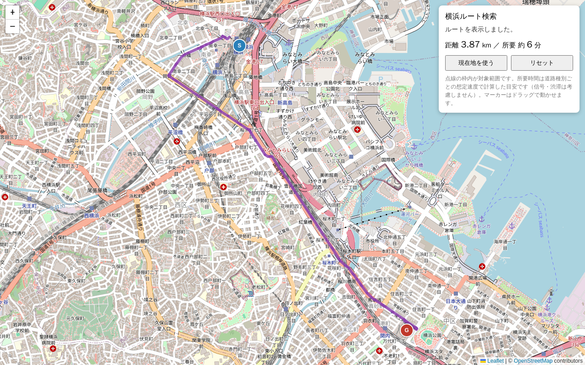

# pgRouting Yokohama demo

Click a start point and a destination on a map of central Yokohama and get the
fastest driving route (PostGIS + pgRouting + osm2pgrouting, OpenStreetMap data).
Everything runs in Docker; the only command you need is `docker compose up`.

No real-time data (closures, traffic) is used.



## Quick start

```bash
docker compose up
```

Open <http://localhost:8080> when this line appears:

```
web-1  | INFO:     Ready: open http://localhost:8080
```

- Click 1 = start (S), click 2 = destination (G). Markers can be dragged.
- 「現在地を使う」 uses browser geolocation (refused with a message outside the area).
- 「リセット」 clears both points.

Port 8080 busy? `WEB_PORT=8110 docker compose up` (or edit `.env`).

### First run vs. later runs

| Step | First run | Later runs |
|---|---|---|
| Build images | 2–5 min | cached |
| Download Kanto extract (~520 MB) | 2–10 min, depends on your connection | cached in `osm_cache` volume |
| Clip + osm2pgrouting import | ~1–3 min | skipped |
| Total | roughly 5–15 min | ~10 s |

The importer prints `[importer] Import finished.` and then exits with code 0.
That's expected: `web` waits for it (`service_completed_successfully`). On later runs
you'll see `[importer] Already imported (...), skipping.` instead.

## Services

| Service | Role |
|---|---|
| `db` | PostgreSQL 17 + PostGIS 3.5 + pgRouting (custom image, see `db/Dockerfile`) |
| `importer` | One-shot job: download → `osmium extract` → `osm2pgrouting` → `sql/post_import.sql` |
| `web` | Python 3.12 + FastAPI + psycopg 3: serves `web/static/index.html` (Leaflet) and `/api/route` |

The DB credentials (`routing`/`routing`) are demo values; the DB port is bound to
127.0.0.1:5452 only (`DB_PORT` to change).

Start order: `db` healthy → `importer` completes successfully → `web` starts.

```
.
├── docker-compose.yml
├── .env                         # BBOX, data URL, web port
├── db/        Dockerfile, init.sql (CREATE EXTENSION)
├── importer/  Dockerfile, import.sh, mapconfig_japan_cars.xml
├── sql/       post_import.sql, nearest_node.sql, route.sql
└── web/       Dockerfile, app.py, requirements.txt, static/index.html
```

## How a route is computed

1. `sql/nearest_node.sql`: nearest intersection (`ways_vertices_pgr`) to each click with
   a KNN `<->` search, limited to nodes in the largest strongly connected component
   (computed once at import with `pgr_strongComponents`). That guarantees a route exists.
2. `sql/route.sql`: `pgr_dijkstra` over `ways` with `cost_s` / `reverse_cost_s`
   (seconds), `directed := true`, then the edges are stitched into GeoJSON.
3. The response carries total `length_m` and `seconds`; the page shows km and minutes.

### Speed assumptions

osm2pgrouting computes `cost_s = length_m / speed`. Speed is the way's OSM `maxspeed`
tag when present, otherwise the default from `importer/mapconfig_japan_cars.xml`:

| highway | km/h | highway | km/h |
|---|---|---|---|
| motorway | 80 | tertiary(_link) | 30 |
| motorway_link | 40 | unclassified | 30 |
| trunk / trunk_link | 50 / 30 | residential | 20 |
| primary / primary_link | 40 / 30 | living_street | 10 |
| secondary / secondary_link | 40 / 30 | service | 10 |

These are free-flow values: no traffic lights, turn penalties or congestion, so real
travel takes longer. Edit the XML and restart to change them (that re-imports).

## Changing the area

Edit `BBOX` in `.env` (`min_lon,min_lat,max_lon,max_lat`, WGS84) and run
`docker compose up` again. The importer stores `BBOX` + mapconfig hash in `import_meta`
and re-imports when either one changes. The download is reused.

Keep the box small. osm2pgrouting loads the whole XML into memory; a box much larger
than ~20 km × 20 km can exhaust Docker Desktop's memory limit. Outside Kanto, change
`OSM_PBF_URL` to another Geofabrik extract.

## Removing data

```bash
docker compose down        # stop, keep data
docker compose down -v     # also delete the DB and the downloaded extract
```

## API

| Endpoint | Description |
|---|---|
| `GET /api/route?from_lat=&from_lon=&to_lat=&to_lon=` | GeoJSON FeatureCollection; `properties` has `length_m`, `seconds` and the snapped nodes. 400 outside the area, 404 when no route. |
| `GET /api/config` | `{"bbox": [min_lon, min_lat, max_lon, max_lat]}` |
| `GET /api/health` | 200 once the import marker exists |

```bash
curl 'http://localhost:8080/api/route?from_lat=35.4658&from_lon=139.6223&to_lat=35.4548&to_lon=139.6317'
```

The SQL lives in `sql/` (mounted into `web`), so you can edit queries and just
`docker compose restart web`.

## Updating the screenshot

With the stack running (adjust the port):

```bash
docker run --rm -v "$PWD:/work" -w /work -e APP_URL=http://host.docker.internal:8080 \
  mcr.microsoft.com/playwright/python:v1.49.1-noble \
  sh -c "pip install -q playwright==1.49.1 && python scripts/capture_screenshot.py"
```

## Data source and etiquette

- **Geofabrik** Kanto extract, clipped locally with osmium. It's one static file download
  per machine, cached afterwards. Overpass API would need no clipping, but the public
  instances are shared and rate-limited, and a city-sized query is heavy for them.
  Please don't put the importer in a loop that re-downloads.
- Map data © OpenStreetMap contributors, ODbL. Tiles come from `tile.openstreetmap.org`,
  which is fine for a local demo but not for production traffic
  ([tile usage policy](https://operations.osmfoundation.org/policies/tiles/)).

## Pitfalls

- **SRID / coordinate order.** All geometry is SRID 4326 (lon/lat degrees).
  `ST_MakePoint(lon, lat)` — x first. Leaflet uses `[lat, lng]`; GeoJSON uses `[lon, lat]`.
  Distances use `::geography` to get meters; `length_m` from osm2pgrouting is meters already.
- **One-way streets.** `cost` is travel along the way's drawing direction, `reverse_cost`
  against it. osm2pgrouting writes a negative `reverse_cost_s` for one-way streets.
  This only works with `directed := true`; with `false` one-way rules are ignored.
  Use `cost_s`/`reverse_cost_s` (time), not `cost`/`reverse_cost` (degrees of length).
- **mapconfig.** It decides which `highway` values are imported and their default speeds.
  `mapconfig_for_cars.xml` (bundled) drops footways and steps, but its speeds are European.
  Use `mapconfig_for_pedestrian.xml` / `_for_bicycles.xml` for other modes.
- **osm2pgrouting input.** It reads OSM XML only (not `.pbf`), hence the osmium step.
- **Apple Silicon.** `postgis/postgis` and `pgrouting/pgrouting` publish amd64 images only.
  Under Rosetta they run slowly or crash, so `db/Dockerfile` installs PostGIS and pgRouting
  from the PGDG apt repo on top of the multi-arch `postgres` image. The importer uses
  Debian's own `osm2pgrouting` package, which is also built for arm64.

## Troubleshooting

| Symptom | Cause / fix |
|---|---|
| `Bind for 0.0.0.0:8080 failed: port is already allocated` | Another app uses 8080. Set `WEB_PORT` in `.env`. |
| `ERROR: relation "import_meta" does not exist` in db log on first run | Expected: the importer checking whether data exists yet. |
| Importer killed / exit 137 | Out of memory in osm2pgrouting. Shrink `BBOX` or raise Docker Desktop memory. |
| Download fails or stalls | Network/proxy issue. Rerun `docker compose up`; the partial file is retried. |
| `dependency failed to start: container ... importer exited (1)` | Check `docker compose logs importer` for the failing step. |
| 「ルートが見つかりませんでした」 | Rare after the strong-component filter; check the points are on land within the box. |
| Changed SQL in `sql/` not applied | `post_import.sql` runs only on import; force one with `docker compose down -v`. |
